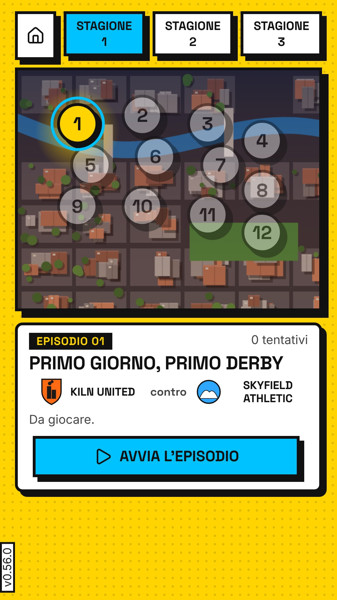
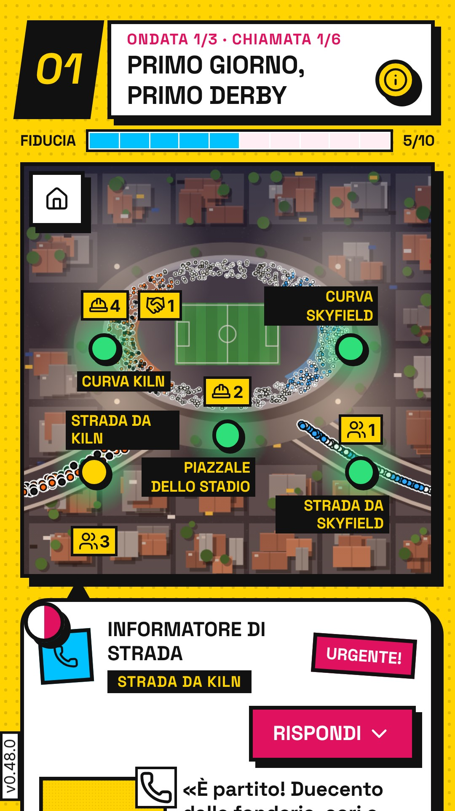
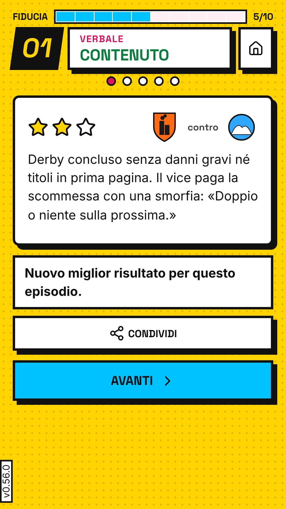

# S-23 · Scheda del Play Store (PO-144, D-226)

Ramo `claude/valmora-store`, partito da `3787b10` (claude/valmora-l1-setup-schema-xdrbx7). Commit del lavoro: **31d1384**. GAME_VERSION non toccato (0.48.0).

## Cosa c'è

- **Cartella scelta: `store/it-IT/`** (scelta tecnica dichiarata: una cartella per lingua della scheda, come le schede localizzate della Play Console).
  - `icona.png`, `grafica.jpg`, `schermata-1.jpg` (home), `schermata-2.jpg` (città), `schermata-3.jpg` (chiamata di e01), `schermata-4.jpg` (verbale di e01), `testi.json` (nome, breve, completa).
- **`tools/store/immagini.mjs`** (100 righe): rigenera tutto. Uso: `npx vite build && node tools/store/immagini.mjs`.
  - Icona: dalla sorgente `tools/icona/icona.svg.mjs`, stessa versione «piena» del lanciatore (`tools/icona/genera.mjs:14`).
  - Grafica 1024×500: costruita dentro la build vera, quindi con `token.css`, caratteri e classi del logo del gioco (`logo-nome`, `logo-sotto`) e l'icona `icone/icona.svg`. Colori solo da token (`var(--colore-fondo)`, `var(--nero)`).
  - Schermate: gioco vero a 360×640 CSS con densità 3 → 1080×1920 (9:16). Gli stati vengono dal motore (giocatore attento di `tools/foto.mjs`, seme 1), messi nel salvataggio, poi «Riprendi». La chiamata è la prima chiamata aperta di e01; il verbale è quello della partita attenta di e01.
  - Scelta tecnica dichiarata: schermate e grafica in **JPEG** (qualità 90). La pagina ammette «JPEG or 24-bit PNG (no alpha)»; Chromium salva i PNG opachi a 24 bit, ma il JPEG evita ogni dubbio sull'alfa.
- **`tools/store/png.mjs`** (34 righe): Chromium salva l'icona opaca come PNG RGB (24 bit) anche con `omitBackground`. Il guardiano l'ha bocciata al primo giro («icona.png: serve PNG a 32 bit con alfa, è png a 24 bit senza alfa»). Il modulo riscrive il PNG in RGBA a 8 bit per canale, alfa 255, pixel identici.
- **`tools/store/misure.mjs`** (133 righe): guardiano. Legge le intestazioni PNG (IHDR) e JPEG (SOF) dai byte, senza dipendenze npm. Controlla dimensioni, bit, alfa, peso e i limiti dei testi. È il passo **«store»** della catena «governo» (`tools/catena.mjs`); i suoi bracci rossi sono nel passo «bracci-rossi».
- **`docs/RILASCIO.md`**: righe 8, 9 e 10 della tabella; versione corrente 0.48.0 → 48000; §3.1 risposte per Data safety; §5 scheda dello store.

## Requisiti verificati (pagine lette il 2026-10-21 con `curl`, HTTP 200, `?hl=en`)

| Requisito | Testo della pagina | Fonte |
|---|---|---|
| icona | «32-bit PNG (with alpha)», «Dimensions: 512px by 512px», «Maximum file size: 1024KB» | https://support.google.com/googleplay/android-developer/answer/9866151 |
| grafica | «JPEG or 24-bit PNG (no alpha)», «Dimensions: 1024px by 500px» | stessa |
| schermate | «JPEG or 24-bit PNG (no alpha)», lato minimo 320 px e massimo 3840 px; per i giochi «three 9:16 portrait screenshots (minimum 1080x1920px)» | stessa |
| descrizione breve | «80 character limit»; niente emoji, simboli (★ ☆), a capo né punteggiatura ripetuta | stessa |
| nome · descrizione completa | «30 character limit» · «4000 character limit» | https://support.google.com/googleplay/android-developer/answer/9859152 |
| Data safety | «"Collect" means transmitting data from your app off a user's device»; esclusa l'elaborazione solo sul dispositivo; non è «sharing» il trasferimento su «user-initiated action» | https://support.google.com/googleplay/android-developer/answer/10787469 |
| fasce d'età | «Ages 5 and under», «6-8», «9-12», «13-15», «16-17», «18 and over»; 13-15 e 16-17 «may be considered to include children in some locales» | https://support.google.com/googleplay/android-developer/answer/9867159 |
| categorie dei giochi | «Action, adventure, arcade, board, card, casino, casual, educational, music, puzzle, racing, role playing, simulation, sports, strategy, trivia, word.» | https://support.google.com/googleplay/android-developer/answer/9859673 |
| pagina privacy pubblicata | `curl`: `…/valmora/privacy` → 301 verso `…/valmora/privacy/` → 200, titolo «Privacy – Valmora» | https://antoniovairo-rgb.github.io/valmora/privacy |

## Misure (FATTO MISURATO)

Comando `node tools/store/misure.mjs` sul commit 31d1384. Le misure vengono dai byte del file, non dalla vista. Controprova indipendente con Pillow: icona `PNG (512, 512) RGBA`, alfa fra 255 e 255; grafica `JPEG (1024, 500) RGB`; schermata-1 `JPEG (1080, 1920) RGB`.

| File | Formato | Misura | Bit | Alfa | Peso |
|---|---|---|---|---|---|
| icona.png | PNG | 512×512 | 32 | sì | 19 091 B (19 KB) |
| grafica.jpg | JPEG | 1024×500 | 24 | no | 57 869 B (57 KB) |
| schermata-1.jpg (home) | JPEG | 1080×1920 | 24 | no | 348 241 B (341 KB) |
| schermata-2.jpg (città) | JPEG | 1080×1920 | 24 | no | 292 357 B (286 KB) |
| schermata-3.jpg (chiamata) | JPEG | 1080×1920 | 24 | no | 362 754 B (355 KB) |
| schermata-4.jpg (verbale) | JPEG | 1080×1920 | 24 | no | 264 023 B (258 KB) |

| Testo | Caratteri (punti di codice) | Limite |
|---|---|---|
| nome | 25 | 30 |
| descrizione breve | 78 | 80 |
| descrizione completa | 1231 | 4000 |

**Ripetibilità.** Prima della correzione, la schermata del verbale cambiava fra un giro e l'altro: 2 diverse su 5 giri, con differenza nel riquadro (47, 287)-(1057, 1569), cioè la transizione d'ingresso. Ora lo script attende la fine delle animazioni (`document.getAnimations()`). Dopo la correzione: 5 giri su 5 con i 6 file identici byte per byte (`sha1sum`).

## Foto delle immagini prodotte

Sono i file veri da caricare, non copie:

| home | città | chiamata (e01) | verbale (e01) |
|---|---|---|---|
|  |  |  |  |

## Guardiani e bracci rossi

| Guardiano | Verde | Rosso |
|---|---|---|
| passo «store» (immagini e testi) | 0 problemi su `store/it-IT` | generatore con `VALMORA_ROSSI=S23I01,S23S01` (globalThis.__NO_…): «icona.png: 1024×1024, serve 512×512» e 4 × «schermata-N.jpg: 360×640, serve 1080×1920», uscita 1 |
| grafica con alfa | – | `VALMORA_ROSSI=S23F01`: «grafica.png: serve JPEG o PNG a 24 bit senza alfa, è png a 32 bit con alfa». Al primo tentativo il rosso **non** mostrava il difetto, perché Chromium salvava il PNG senza alfa: interruttore cieco, riparato passando il file da `rgba()` |
| bracci rossi nella catena (`storeCiechi`, 10 campioni ricavati dai file veri) | `[]` (nessun cieco) | icona a 1024 px, icona senza alfa, icona oltre 1024 KB, grafica PNG con alfa, schermata 1080×640, solo 2 schermate, breve di 81, nome di 31, completa di 4001, «★» nella breve: tutti visti |

La soglia del peso delle schermate (8 MB) è una scelta prudente dichiarata: la pagina dice «up to 8 MB each» solo per Android Automotive OS.

## Testi (store/it-IT/testi.json)

- **Nome**: «Valmora – Cortina di fumo».
- **Breve**: «Tieni calma una città inventata nei giorni di partita. Gioco offline a episodi».
- **Completa**: vedi il file. Ogni fatto ha una fonte:
  - 36 episodi in tre stagioni: `data/missioni` ha 36 file; la città mostra Stagione 1/2/3.
  - Unità sulla mappa, chiamate e verbale: le schermate 2-4. Verbale fino a tre stelle, rigioco col risultato migliore: `src/logica/episodi.ts:1-6`.
  - Chi chiama: centrale radio, informatori, comando, residenti, dai campi `fonte` di `data/missioni`.
  - Ogni risposta ha un costo: D-078. La fiducia sale e scende: barra «FIDUCIA», 5/10 → 6/10 nelle schermate.
  - Derby fra quartieri, fonti contraddittorie, chi usa i disordini come copertura: D-021, D-022, D-069. Violenza fuori campo: CLAUDE.md.
  - Offline, nessuna pubblicità, account o statistica, salvataggio solo sul dispositivo: privacy.json (S-22).
  - Avviso di finzione: copiato dalla home (schermata-1).
- Esclusi perché non verificati: la durata delle missioni («circa 7 minuti», solo nel pacchetto di prompt) e «13 club» (BIBBIA: «da confermare»).

## Opzioni per il PO (le sceglie il PO; consigliata per prima)

**1. Fascia d'età del pubblico** (RILASCIO.md riga 10; answer 9867159)
1. **Solo «18 and over»** (consigliata). Niente obblighi della politica Famiglie. Il tema (ordine pubblico, curve, un capo curva con affari illeciti) è da adulti. Costo: si dichiara un pubblico più ristretto; la pagina permette anche di limitare l'accesso ai minori («Restrict Minor Access»), che è facoltativo.
2. **«16-17» e «18 and over»**. Costo: per la pagina 16-17 «may be considered to include children in some locales». Se scatti la politica Famiglie e con quali obblighi: Non posso confermarlo senza leggere i requisiti Famiglie, un lavoro in più prima del test.
3. **«13-15», «16-17» e «18 and over»**. Costo: come la 2, con più paesi in cui la fascia conta come minori. Va riletta la politica Famiglie per intero; il questionario IARC decide comunque il rating.

**2. Categoria nella Play Console** (answer 9859673)
1. **Strategy / Strategia** (consigliata). Il cuore del gioco è schierare le unità sulla mappa e scegliere le risposte con un costo. Costo: nessuno noto.
2. **Simulation / Simulazione**. Costo: suggerisce un simulatore realistico, mentre il gioco è a episodi narrativi e le missioni sono decise dai dati.
3. **Casual**. Costo: descrive peggio scelte e costi; più concorrenza di giochi diversi.

**3. Tono della descrizione**
1. **Sobria, a sezioni (quella nel file)** (consigliata). Solo fatti verificati, regole chiare. Costo: meno «gancio» narrativo.
2. **Più narrativa**: apertura in seconda persona sul primo derby e su Malvasi, poi le stesse sezioni. Costo: 1 giro di scrittura e guardiano; ogni frase nuova va ricontrollata sui dati.
3. **Breve alternativa**: «Ordine pubblico nei giorni di partita: schiera, rispondi, tieni la città calma» (77 caratteri). Costo: non dice «offline», che oggi è il vantaggio più chiaro.

## Non verificato

- **Telefono vero**: le schermate sono di Chromium a 360×640 con densità 3, non di un telefono Android. «0 richieste esterne» è una misura in Chromium (S-22), non sull'APK/AAB (D-216).
- **allowBackup**: se il backup Android del salvataggio conti come «raccolta» per Data safety: Non posso confermarlo (D-216). La pagina definisce «collect» come trasmissione «from your app off a user's device» e non nomina il backup di sistema.
- **Resa nella Play Console**: come la console ritaglia o mostra la grafica 1024×500 e le schermate, e se accetta il carattere «–» nel nome. Non posso confermarlo prima del caricamento del PO.
- **Menu della Play Console**: il percorso fino a «Main store listing». La pagina nomina la pagina, non il menu.
- **Icona**: i requisiti di «Google Play's icon design specifications» (pagina collegata) non li ho letti. Ho verificato solo formato, misura e peso.

## Catene e CI

Esecutore: `node tools/catena.mjs completa`, con `set -o pipefail`, sullo stesso hash **31d1384**. Ogni giro è in STABILITA.json, anche quelli non validi.

| Giro (data UTC) | Modo | Esito | Nota |
|---|---|---|---|
| 21/10 21:27 | 3 giri in parallelo, 4 core | **INSTABILE** | `bracci-rossi-grafica`: «altezze/C187V01 è cieco» al tentativo 1, verde al 2 |
| 21/10 22:09 (2 giri) | in parallelo, worktree separati | **ROSSO** | passo `foto`, 3 tentativi: «browser.newPage: Target page, context or browser has been closed». Poi i processi sono stati chiusi dal limite di 2 h del mio comando in sottofondo |
| 22/10 00:10 | in sequenza | **VERDE** | tutti i passi verdi, nessun nuovo tentativo |
| 22/10 01:31 | in sequenza | **VERDE** | tutti i passi verdi, nessun nuovo tentativo |
| giro 3 sequenziale, prove 1 e 2 | in sequenza | **interrotto** ×2 | il contenitore è stato riavviato due volte durante il giro; la seconda volta dopo «altezze» verde. Giri non registrati, rifatto da capo |
| 22/10 04:29 | in sequenza | **VERDE** | tutti i 24 passi verdi, nessun nuovo tentativo |

**Esito valido: 3 giri sequenziali VERDI su 31d1384** (00:10, 01:31, 04:29 UTC), senza modifiche non committate e senza passi instabili.

**Ritiro la prima serie.** Lanciare 3 catene in parallelo è stato un errore mio di metodo, fatto per guadagnare tempo: quei 3 giri non contano.
- IPOTESI sulla causa, non misurata: il carico. Nella foto del giro rosso il primo tentativo è durato 2751 s, contro 1594 s del giro instabile.
- C187V01 è la **prima instabilità registrata in 1256 giri**: verificato con `git show 31d1384:STABILITA.json`, 0 giri instabili.
- Il braccio C187V01 campiona il cambio di scena ogni 20 ms (tools/sonda-altezze.mjs:144). Se la macchina è lenta, la transizione può sfuggire ai campioni.
- Proposta per la principale, non applicata perché è fuori dal mio compito: rendere il campionamento indipendente dal carico, per esempio fermando le animazioni della scena appena compaiono due `.scena`. Va riprodotta prima con carico simulato.

**CI «catene»** su 31d1384: run 39678910686, **success**, 10 job su 10 (governo, logica, cambi, apk, aab, grafica 360 foto/bracci/schieramenti, 375, 412). CI dell'ultimo commit (rapporto): la verifica la principale, oppure arriva nel messaggio di consegna.

## Hash

- Lavoro: 31d1384 · Rapporto: (questo commit)
